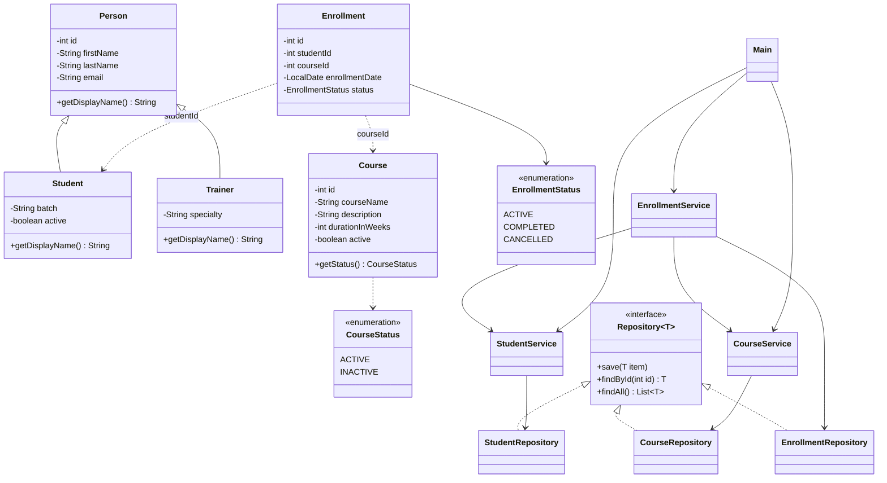

# LearnTrack: Student & Course Management System

LearnTrack is a console-based Student & Course Management System built with **Core Java**. An administrator can manage students, courses and enrollments through a menu-driven interface. All data is kept in memory (`ArrayList`), so nothing is saved after the program exits.

The project is meant to practice Java fundamentals: classes and objects, constructors, static vs. instance members, encapsulation, inheritance, polymorphism, abstraction, collections, enums, basic exception handling, and clean, layered code.

## Features

The main menu has three screens, each with its own submenu.

| Screen | Options |
| --- | --- |
| **Student Management** | Add student, view all students, search by ID, update student (choose batch or status) |
| **Course Management** | Add course, view all courses, update course (choose duration or status) |
| **Enrollment Management** | Enroll a student in a course, view enrollments for a student, mark an enrollment completed, mark an enrollment cancelled, view all enrollments |

Rules:
- Students and courses are never deleted. They are deactivated (`active = false`) so enrollment history is kept. A student or course is deactivated or reactivated through its "Update" option.
- Updating a student lets the admin choose to change either the batch or the active/inactive status. Name and email cannot be changed.
- Updating a course lets the admin choose to change either the duration or the active/inactive status. Name and description cannot be changed.
- Only active students can enroll, and only in active courses.
- A student cannot have two `ACTIVE` enrollments in the same course.
- Only an `ACTIVE` enrollment can be marked `COMPLETED` or `CANCELLED`.
- Invalid menu options, non-numeric input and unknown IDs show a clear message instead of crashing.

## Requirements

- JDK 17 or later
- No external libraries or build tools

## How to Compile and Run

From the project root:

```bash
# macOS / Linux
javac -d out $(find src -name "*.java")
java -cp out com.airtribe.learntrack.Main
```

```powershell
# Windows PowerShell
Get-ChildItem -Recurse src -Filter *.java | ForEach-Object { $_.FullName } | Set-Content sources.txt
javac -d out "@sources.txt"
java -cp out com.airtribe.learntrack.ui.Main
```

Sample session:

```text
=== LearnTrack ===

--- Main Menu ---
1. Student Management
2. Course Management
3. Enrollment Management
0. Exit
Option: 1
...
Option: 1
First name: Asha
Last name: Rao
Email (optional): asha@example.com
Batch: B1
ID=1001, name=Student: Asha Rao, email=asha@example.com, batch=B1, active=true
```

## Project Structure

```text
src/com/airtribe/learntrack/
├── ui/            Main.java                      Menus and input only
├── service/       StudentService, CourseService, EnrollmentService   Business rules
├── repository/    Repository<T>, StudentRepository, CourseRepository, EnrollmentRepository   In-memory storage
├── entity/        Person, Student, Trainer, Course, Enrollment
├── enums/         EnrollmentStatus, CourseStatus
├── exception/     EntityNotFoundException, InvalidInputException
├── util/          IdGenerator, InputValidator
└── constants/     AppConstants, MenuOptions
```

Layers: `Main` (UI) calls services, services apply validation and rules and call repositories, and repositories store entities in `ArrayList`s.

## Class Diagram



## Core Java Concepts Demonstrated

- **Packages and access modifiers:** each layer lives in its own package, with private fields and public methods.
- **Encapsulation:** entities use private fields with getters and setters.
- **Constructors:** `Student` has overloaded constructors, with and without email, and a default constructor.
- **Inheritance and polymorphism:** `Student` and `Trainer` extend `Person`, use `super(...)`, and override `getDisplayName()`.
- **Abstraction:** the `Repository<T>` interface defines the storage contract that the three repositories implement.
- **Static members:** `IdGenerator` keeps static ID counters, and `AppConstants` and `MenuOptions` hold shared constants.
- **Enums:** `EnrollmentStatus` and `CourseStatus` represent fixed states.
- **Collections:** `ArrayList` stores all data in memory.
- **Exception handling:** custom `EntityNotFoundException` and `InvalidInputException`, with `try/catch` around menu operations and input parsing.
- **Control flow:** menu loops, `switch` and `if/else`.

## Design Notes

- **Why `ArrayList`:** it grows as students, courses and enrollments are added, whereas an array has a fixed size that would need manual resizing.
- **Static members:** `IdGenerator` counters give each entity a unique ID, and constants are shared across the app without creating objects.
- **Inheritance:** `Person` holds the fields and behavior common to `Student` and `Trainer`, so they are written once and each subclass adds only what is specific to it.
- **Separation of concerns:** `Main` only shows menus, reads input and calls services. Services hold the business rules, and repositories only store and find data.
- **Entities are built in the UI:** `Main` creates a `Student` or `Course` object from user input and passes it to the service for add and update.

## Notes

- IDs start at 1001 for students, 2001 for courses and 3001 for enrollments.
- Data is lost when the application exits.
